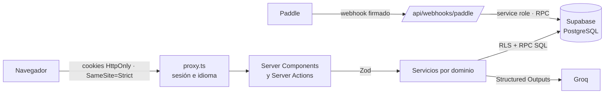

# Wiseit

[](https://github.com/maxxfley/wiseit-v2/actions/workflows/ci.yml)

**Rutas de aprendizaje visuales generadas con IA.** Escribís un tema y Wiseit arma una ruta progresiva (Básico → Intermedio → Avanzado) como un mapa interactivo de prerrequisitos, con conceptos para tildar, material de estudio buscado en la web y la opción de extender la ruta cuando la terminás.

🔗 **Demo:** [wiseit.vercel.app](https://wiseit.vercel.app) · 🌐 Español · English · Русский

> Los pagos corren en el **sandbox de Paddle**: se puede probar el flujo de suscripción con la tarjeta de prueba `4242 4242 4242 4242` sin cobros reales.

---

## Funcionalidades

| | Gratis | Premium |
|---|---|---|
| **Generar rutas con IA** | 4 por día, hasta 4 guardadas | 10 por día, sin tope de rutas, modelo más potente |
| **Mapa interactivo** (grafo de prerrequisitos) | Explorar y leer | Explorar y leer |
| **Progreso** (tildar conceptos, completar, desbloquear) | Primer tema de cada ruta | Completo |
| **Buscar material** (búsqueda web con IA) | 1 link por ruta (hasta 4 en total) | 5 fuentes por tema, 15 búsquedas por día |
| **Avanzar más** (extender una ruta) | Vista previa de los temas | 3 a 6 temas nuevos, hasta 4 extensiones por ruta |

Premium cuesta US$4,99 por mes o US$44,99 por año.

Además: registro con confirmación de email, recuperación de contraseña, interfaz y contenido generado en tres idiomas, y suscripción mensual o anual con portal de autogestión.

## Stack

- **Frontend:** Next.js 16 (App Router, Server Components, `cacheComponents`) · React 19 · TypeScript estricto · Tailwind CSS 4
- **Backend:** Supabase (PostgreSQL + Auth + Row Level Security), Server Actions y un Route Handler para el webhook
- **IA:** Groq (`gpt-oss-20b` / `gpt-oss-120b`) con Structured Outputs validados con Zod y búsqueda web integrada
- **Pagos:** Paddle Billing (Merchant of Record)
- **Mapa:** React Flow + dagre
- **Calidad:** Vitest, ESLint, GitHub Actions · **Deploy:** Vercel

## Arquitectura



- **Todo acceso a datos ocurre en el servidor.** No existe un cliente de Supabase en el navegador: la sesión vive en cookies `HttpOnly` que el JavaScript del cliente no puede leer.
- **La base hace cumplir las reglas de negocio.** Cuotas, límites por plan, bloqueos de progreso y altas atómicas viven en funciones SQL con locks. Ocultar un botón en la UI nunca es la única defensa.
- **Organización por dominio** (`src/features/`): `auth`, `roadmaps`, `materials`, `extensions`, `plans` y `landing`, cada uno con sus `actions`, `services`, `schemas` y `components`.

## Decisiones técnicas destacadas

- **Salida de la IA estructurada y validada.** El JSON Schema que recibe Groq se genera desde Zod, y la respuesta se vuelve a validar en el servidor. El grafo de prerrequisitos es **acíclico por construcción**: solo se aceptan requisitos hacia temas anteriores.
- **Links sin alucinaciones.** "Buscar material" hace dos pasos: una búsqueda web real y después una selección estructurada en la que el modelo elige **por número de candidato**. Nunca escribe URLs, así que solo llegan al usuario links que salieron de la búsqueda.
- **Prompt injection acotado.** El tema del usuario viaja como dato JSON, nunca dentro del prompt de sistema, y la salida es solo texto validado, sin acciones.
- **Cuotas justas.** Si Groq rechaza un pedido sin procesarlo (servicio saturado), el intento se devuelve automáticamente. Ante una salida inválida se reintenta una vez sin consumir otro cupo.
- **Webhook robusto.** Firma verificada sobre el cuerpo crudo, eventos idempotentes, descarte de eventos viejos y un advisory lock por usuario para eventos que llegan simultáneamente.
- **Seguridad (OWASP).** RLS en todas las tablas, `anon` sin privilegios, protección contra open redirect en `?next=`, cabeceras de seguridad (HSTS, `frame-ancestors`, nosniff), validación de entorno con Zod y errores técnicos solo en los logs del servidor.
- **i18n sin librerías.** Diccionarios tipados: si a un idioma le falta una clave, el `typecheck` falla. Las Server Actions devuelven claves de mensaje que el cliente traduce.

## Estructura

```
src/
├── app/[lang]/        # Rutas con prefijo de idioma (landing, auth, dashboard, pricing)
├── app/api/           # Webhook de Paddle
├── features/          # Dominios de negocio (actions, services, schemas, components)
├── components/        # UI y layout compartidos
├── lib/               # Clientes de Supabase, Groq, Paddle e i18n
├── locales/           # Diccionarios es / en / ru
├── config/            # Límites, rutas y cabeceras de seguridad
├── utils/             # Funciones puras
└── proxy.ts           # Sesión, idioma y protección de rutas
supabase/
├── migrations/        # Esquema, RLS, funciones y triggers
└── checks/            # Verificación de seguridad y smoke tests
```

## Correr el proyecto en local

Requisitos: Node 24, un proyecto de Supabase, una API key de Groq y (opcional) una cuenta sandbox de Paddle.

```bash
git clone https://github.com/maxxfley/wiseit-v2.git
cd wiseit-v2
npm install
cp .env.example .env.local   # completar las variables (ver comentarios en el archivo)
npm run db:link              # enlazar el proyecto de Supabase
npm run db:push              # aplicar las migraciones
npm run dev
```

| Script | Qué hace |
|---|---|
| `npm run dev` / `build` / `start` | Desarrollo, build y servidor de producción |
| `npm run lint` · `npm run typecheck` | ESLint y TypeScript (genera los tipos de rutas antes) |
| `npm test` · `npm run test:watch` | Tests unitarios con Vitest |
| `npm run db:types` | Regenera los tipos de TypeScript desde la base |
| `npm run db:verify` | Verifica RLS, políticas, funciones y permisos (solo lectura) |
| `npm run db:smoke` | Prueba el aislamiento entre usuarios dentro de una transacción con `ROLLBACK` |

## Tests y CI

- **Unitarios (Vitest, 77 casos):** normalización del grafo de la IA, protección contra open redirect, estado y progreso de los nodos, eventos del webhook de Paddle y schemas de validación. Cada test vive junto al archivo que prueba (`*.test.ts`).
- **Base de datos:** `verify_setup.sql` revisa 79 controles de seguridad y `smoke_rls.sql` prueba aislamiento RLS, cuotas, webhook y progreso.
- **GitHub Actions**, en cada PR y push a `main`:
  1. **quality:** lint → typecheck → tests → build.
  2. **database:** levanta Postgres con el CLI de Supabase, aplica todas las migraciones sobre una base vacía y corre las dos verificaciones SQL.

Reglas que hace cumplir el linter: sin `any`, sin `catch` vacíos y archivos de 150 líneas como máximo.

## Autor

**Máximo Fleitas** · [GitHub](https://github.com/maxxfley)
